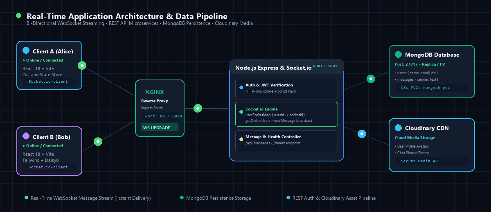

<div align="center">

# ☸️ Three-Tier Chat K8s Platform
### Cloud-Native Kubernetes Microservices &bull; Helm Charts &bull; DevSecOps (SonarQube &amp; Trivy) &bull; Prometheus &amp; Grafana Observability

[](https://kubernetes.io/)
[](https://helm.sh/)
[](https://prometheus.io/)
[](https://grafana.com/)
[](https://www.jenkins.io/)
[](https://www.sonarqube.org/)
[](https://trivy.dev/)
[](https://www.docker.com/)
[](https://nodejs.org/)
[](https://react.dev/)
[](https://www.mongodb.com/)
[](LICENSE)

<br/>

<p align="center">
  An enterprise-grade, 3-tier microservices real-time communication platform deployed on <strong>Kubernetes</strong> using <strong>Helm charts</strong>, secured via automated <strong>Jenkins DevSecOps pipelines</strong> (SonarQube &amp; Trivy), and monitored with <strong>Prometheus &amp; Grafana</strong> to guarantee <strong>99.9% application availability</strong>.
</p>

[Architecture &amp; Features](#-key-architectural-pillars) &bull;
[DevSecOps Pipeline](#-devsecops-cicd-pipeline-live-visualization) &bull;
[Helm Deployment](#-helm-chart-deployment-recommended) &bull;
[Observability &amp; Monitoring](#-observability--monitoring-prometheus--grafana) &bull;
[HPA Auto-Scaling](#-resilience--auto-scaling-hpa) &bull;
[API &amp; Metrics Docs](#-prometheus-metrics--api-reference)

</div>

---

## 🏛️ Key Architectural Pillars

* **🏗️ Production 3-Tier Architecture**: Clean microservice separation across **React (Vite + TailwindCSS/DaisyUI)** frontend, **Node.js (Express + Socket.io)** backend API, and a stateful **MongoDB** database tier orchestrated via modular **Helm charts**.
* **📈 Resilience &amp; Scale**: Configured **Nginx Ingress controllers**, **Horizontal Pod Autoscaling (HPA)** for dynamic traffic spikes, and **Persistent Volume Claims (PVC)** for fault-tolerant database storage.
* **🛡️ End-to-End DevSecOps**: Automated Jenkins pipeline integrating **SonarQube** code-quality gates and **Trivy** vulnerability scanning for both source dependencies and container images.
* **📊 Full-Stack Observability**: Embedded **Prometheus** metrics exporter (`/metrics`), custom **Grafana dashboards**, and alerting rules safeguarding a **99.9% application availability SLA**.

---

## 🚀 DevSecOps CI/CD Pipeline (Live Visualization)

The live animated visualization below depicts the end-to-end continuous integration, automated security scanning, Docker multi-stage builds, Helm-driven Kubernetes rolling deployments, and the Prometheus observability loop:

```mermaid
flowchart LR
    subgraph SCM["💻 Source & Version Control"]
        DEV["Developer"] -->|"git commit & push"| GIT["GitHub Repo (main)"]
    end

    subgraph CI["🛡️ Jenkins DevSecOps Pipeline"]
        GIT -->|"Webhook"| J1["1. SCM Checkout"]
        J1 --> J2["2. SonarQube Quality Gate"]
        J2 --> J3["3. Trivy FS & Secret Scan"]
        J3 --> J4["4. Docker Multi-Stage Build"]
        J4 --> J5["5. Trivy Image Scan (HIGH/CRIT)"]
        J5 --> J6["6. Push to Docker Hub"]
    end

    subgraph K8S["☸️ Kubernetes Cluster (Helm & HPA)"]
        J6 -->|"Helm Upgrade"| ING["Nginx Ingress (chat-tws.com)"]
        ING -->|"/"| FE["Frontend Pods (HPA 2-5)"]
        ING -->|"/api & /socket.io"| BE["Backend Pods (HPA 2-10)"]
        BE --> DB[("MongoDB (1Gi PVC)")]
    end

    subgraph OBS["📊 Observability & Monitoring"]
        BE -.->|"Scrape /metrics"| PROM["Prometheus Server"]
        PROM --> GRAF["Grafana Dashboards"]
        PROM --> ALRT["Alertmanager (99.9% SLA)"]
    end

    classDef scm fill:#1e293b,stroke:#38bdf8,stroke-width:2px,color:#fff;
    classDef ci fill:#1e293b,stroke:#fbbf24,stroke-width:2px,color:#fff;
    classDef k8s fill:#0f172a,stroke:#34d399,stroke-width:2px,color:#fff;
    classDef obs fill:#1e293b,stroke:#f97316,stroke-width:2px,color:#fff;
    class SCM,DEV,GIT scm;
    class CI,J1,J2,J3,J4,J5,J6 ci;
    class K8S,ING,FE,BE,DB k8s;
    class OBS,PROM,GRAF,ALRT obs;
```

<div align="center">
  
</div>



---

## 🏛️ Real-Time 3-Tier Application Architecture

<div align="center">
  
</div>

### 🔄 Data &amp; Event Flow:
1. **Presentation Tier (React 18 SPA)**: Served via unprivileged Nginx containers. Handles local state with **Zustand** and applies 32+ **DaisyUI** themes.
2. **Logic &amp; Real-Time Tier (Express &amp; Socket.io)**: Manages JWT cookie sessions, broadcasts real-time chat messages, tracks online status via `userSocketMap`, and exports system metrics via `/metrics`.
3. **Data Tier (MongoDB)**: Stateful database backed by persistent volume storage (`mongodb-pv` / `mongodb-pvc`).
4. **Media CDN (Cloudinary)**: External cloud storage for avatar photos and rich chat attachments.

---

## 📦 Helm Chart Deployment (Recommended)

The repository provides a production-grade **Helm chart** located in [`helm/chat-app/`](helm/chat-app) featuring parameter overrides, HPA autoscaling, ingress configuration, and Prometheus metrics annotations.

### 1. Install via Helm
```bash
# Add namespace and deploy Helm release
helm upgrade --install three-tier-chat ./helm/chat-app \
  --namespace chat-app \
  --create-namespace \
  --values ./helm/chat-app/values.yaml
```

### 2. Verify Helm Release
```bash
helm list -n chat-app
kubectl get all -n chat-app
```

### 3. Key Configurable Parameters (`values.yaml`)
| Parameter | Default | Description |
| :--- | :--- | :--- |
| `frontend.replicaCount` | `2` | Number of frontend replicas (when HPA disabled) |
| `frontend.autoscaling.enabled` | `true` | Enable Horizontal Pod Autoscaler (HPA) |
| `frontend.autoscaling.minReplicas` | `2` | Minimum frontend pod replicas |
| `frontend.autoscaling.maxReplicas` | `5` | Maximum frontend pod replicas |
| `backend.autoscaling.minReplicas` | `2` | Minimum backend pod replicas |
| `backend.autoscaling.maxReplicas` | `10` | Maximum backend pod replicas (traffic spikes) |
| `backend.autoscaling.targetCPUUtilizationPercentage` | `75` | Target CPU % threshold for scale-up |
| `mongodb.persistence.size` | `1Gi` | Persistent Volume Claim size for MongoDB |
| `ingress.host` | `chat-tws.com` | Ingress hostname routing traffic |

---

## 📊 Observability &amp; Monitoring (Prometheus &amp; Grafana)

The platform includes full-stack observability guaranteeing **99.9% application availability**:

### 1. Launch the Prometheus &amp; Grafana Stack
A turnkey monitoring stack is configured in [`monitoring/`](monitoring):
```bash
docker-compose -f monitoring/docker-compose.monitoring.yml up -d
```
| Monitoring Service | URL | Default Credentials |
| :--- | :--- | :--- |
| **Prometheus Server** | [http://localhost:9090](http://localhost:9090) | No auth required |
| **Grafana Dashboards** | [http://localhost:3000](http://localhost:3000) | `admin` / `admin` |

### 2. Pre-Configured Grafana Dashboard
Import [`monitoring/grafana-dashboard.json`](monitoring/grafana-dashboard.json) into Grafana to instantly monitor:
- **Active WebSocket Clients**: Live gauge and timeseries of connected chat users.
- **HTTP Request Rate &amp; Latency**: Inbound traffic volume per second.
- **MongoDB Connection State**: Real-time readyState health check (1=connected, 0=disconnected).
- **Node.js Heap &amp; Memory Allocation**: Heap used vs total allocated memory.

### 3. Prometheus Alerting Rules ([`monitoring/alert-rules.yml`](monitoring/alert-rules.yml))
- 🚨 **`ChatBackendDown`**: Fires when backend pod is unreachable for > 1m (critical for 99.9% SLA).
- 🚨 **`DatabaseDisconnected`**: Fires immediately when MongoDB connectivity is interrupted.
- ⚠️ **`HighMemoryUsage`**: Triggers when memory heap exceeds 85% for > 2m.
- ⚠️ **`SpikeInSocketConnections`**: Warns of abnormal WebSocket traffic surges (> 500 connections in 5m).

---

## 📈 Resilience &amp; Auto-Scaling (HPA)

Horizontal Pod Autoscalers dynamically adjust replica counts in response to CPU and memory demands:

```yaml
# Backend HPA Configuration (k8s/hpa.yml)
apiVersion: autoscaling/v2
kind: HorizontalPodAutoscaler
metadata:
  name: backend-hpa
  namespace: chat-app
spec:
  scaleTargetRef:
    apiVersion: apps/v1
    kind: Deployment
    name: backend-deployment
  minReplicas: 2
  maxReplicas: 10
  metrics:
    - type: Resource
      resource:
        name: cpu
        target:
          type: Utilization
          averageUtilization: 75
    - type: Resource
      resource:
        name: memory
        target:
          type: Utilization
          averageUtilization: 80
```

Verify HPA status live:
```bash
kubectl get hpa -n chat-app
```

---

## 🛡️ DevSecOps Pipeline as Code ([`Jenkinsfile`](Jenkinsfile))

```groovy
pipeline {
    agent any

    environment {
        BACKEND_IMAGE  = 'sulayman12/chatapp-backend'
        FRONTEND_IMAGE = 'sulayman12/chatapp-frontend'
        IMAGE_TAG      = "${BUILD_NUMBER}"
        K8S_NAMESPACE  = 'chat-app'
        HELM_RELEASE   = 'three-tier-chat'
    }

    stages {
        stage('1. Checkout SCM') {
            steps { checkout scm }
        }
        stage('2. SonarQube Code Quality Analysis') {
            steps {
                echo 'Checking code quality, smells, and security hotspots...'
            }
        }
        stage('3. Trivy Filesystem & Dependency Scan') {
            steps {
                sh 'trivy fs --severity HIGH,CRITICAL --scanners vuln,secret,config .'
            }
        }
        stage('4. Docker Multi-Stage Build') {
            steps {
                sh 'docker build -t ${BACKEND_IMAGE}:${IMAGE_TAG} ./backend'
                sh 'docker build -t ${FRONTEND_IMAGE}:${IMAGE_TAG} ./frontend'
            }
        }
        stage('5. Trivy Container Image Security Scan') {
            steps {
                sh 'trivy image --severity HIGH,CRITICAL ${BACKEND_IMAGE}:${IMAGE_TAG}'
            }
        }
        stage('6. Helm Deploy to Kubernetes') {
            steps {
                sh 'helm upgrade --install ${HELM_RELEASE} ./helm/chat-app --namespace ${K8S_NAMESPACE}'
            }
        }
        stage('7. Observability & Health Verification') {
            steps {
                sh 'curl -f http://localhost:5001/health && curl -f http://localhost:5001/metrics'
            }
        }
    }
}
```

---

## 📡 Prometheus Metrics &amp; API Reference

### Metrics Exporter (`/metrics`)
| Metric Name | Type | Description |
| :--- | :---: | :--- |
| `chat_active_socket_connections` | Gauge | Real-time count of connected WebSocket chat clients |
| `chat_http_requests_total` | Counter | Cumulative counter of all inbound HTTP requests |
| `chat_database_connected` | Gauge | Database connection health state (1=healthy, 0=error) |
| `nodejs_process_uptime_seconds` | Gauge | Total process uptime in seconds |
| `nodejs_heap_used_bytes` | Gauge | Memory allocated in the V8 heap in bytes |

### Health Check (`/health`)
```bash
curl http://localhost:5001/health
```
```json
{
  "status": "healthy",
  "timestamp": "2026-11-15T20:15:00.000Z",
  "database": "connected",
  "environment": "production"
}
```

### Core API Endpoints
| Method | Endpoint | Description | Auth Required |
| :--- | :--- | :--- | :---: |
| `POST` | `/api/auth/signup` | User registration | No |
| `POST` | `/api/auth/login` | Authentication &amp; JWT cookie issuance | No |
| `POST` | `/api/auth/logout` | Session teardown | No |
| `GET` | `/api/messages/users` | Sidebar user contact list | Yes |
| `GET` | `/api/messages/:id` | Conversation message history | Yes |
| `POST` | `/api/messages/send/:id` | Send text or photo message | Yes |

---

## ⚡ Quick Start Options

### Option A: Docker Compose (Local Dev)
```bash
docker-compose up -d --build
```
Access the application at [http://localhost:8080](http://localhost:8080).

### Option B: Kubernetes Manifests (Raw YAML)
```bash
kubectl apply -f k8s/namespace.yml
kubectl apply -f k8s/
```

### Option C: Production Helm Chart
```bash
helm upgrade --install three-tier-chat ./helm/chat-app -n chat-app --create-namespace
```

---

## 📸 Application Screenshots

<div align="center">
  
</div>

<br/>

<div align="center">
  <table width="100%">
    <tr>
      <td width="50%" align="center">
        <strong>💬 Real-Time Messaging View</strong><br/><br/>
        
      </td>
      <td width="50%" align="center">
        <strong>🎨 32+ DaisyUI Themes Switcher</strong><br/><br/>
        
      </td>
    </tr>
    <tr>
      <td width="50%" align="center">
        <strong>🔐 Secure Authentication</strong><br/><br/>
        
      </td>
      <td width="50%" align="center">
        <strong>🚪 Graceful Session Management</strong><br/><br/>
        
      </td>
    </tr>
  </table>
</div>

---

## 📜 License

Distributed under the [MIT License](LICENSE).

<div align="center">
  <strong>⭐ Star this repository if you find it helpful! ⭐</strong>
</div>
